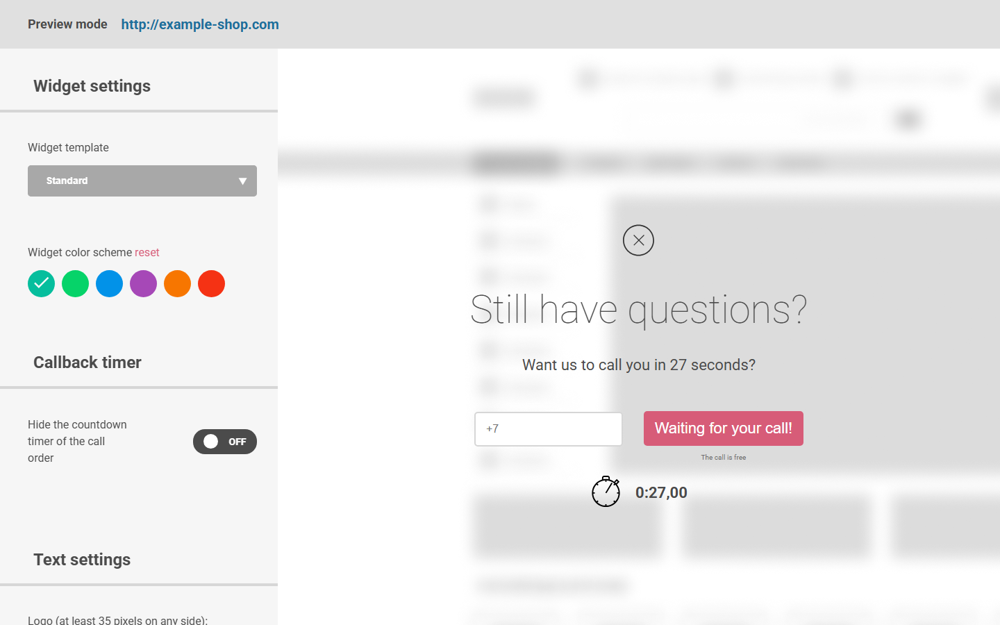
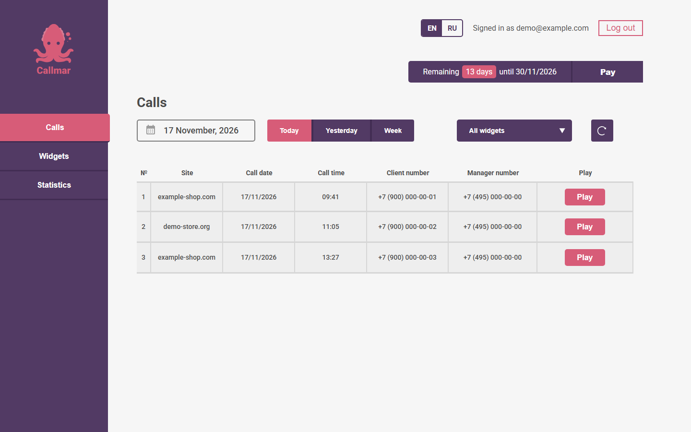
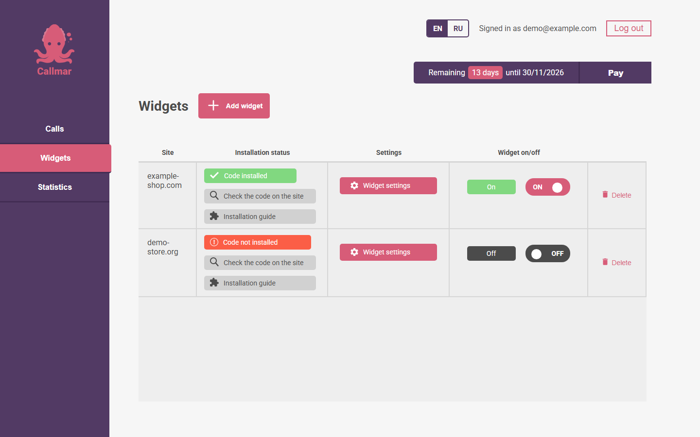
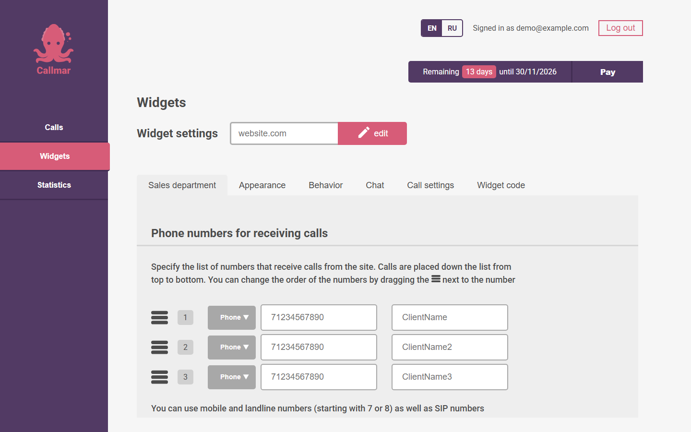
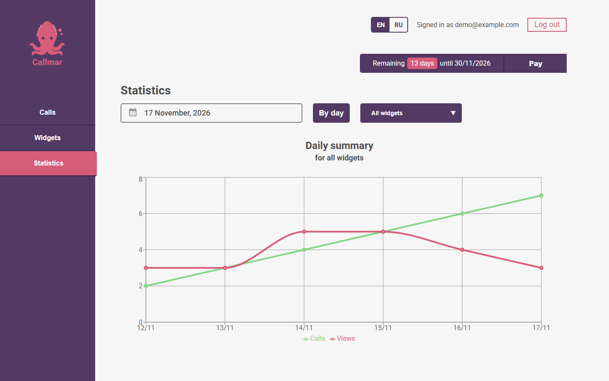
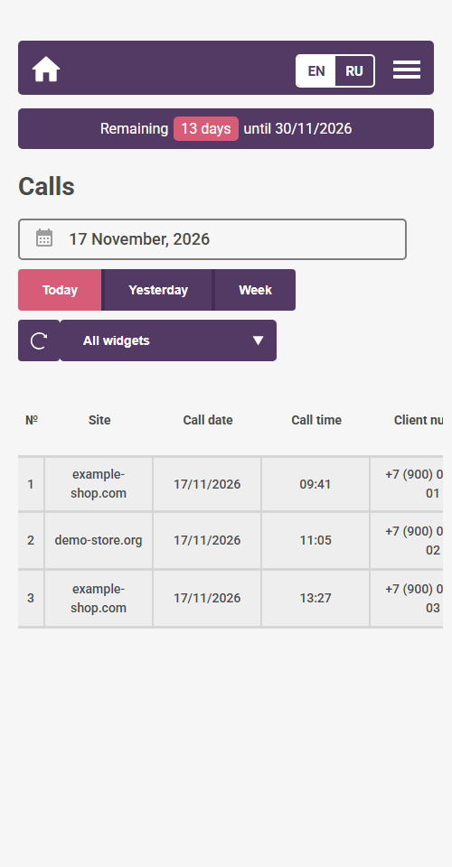
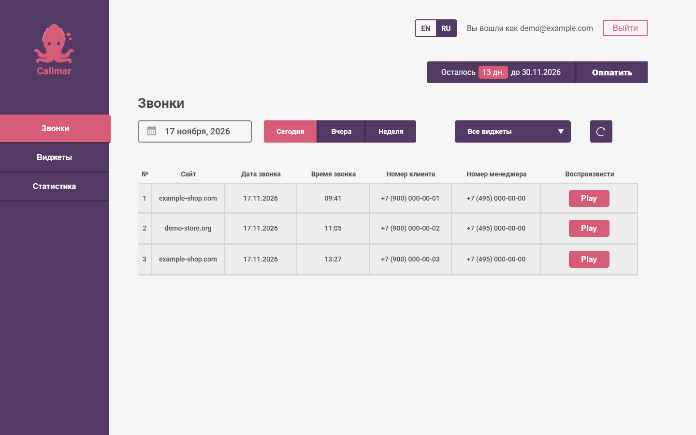

# Callmar Panel

**Freelance project** · **Design:** the client's Figma mockups · **Implementation:** me (frontend only)

Admin dashboard for **Callmar**, a callback-widget service: a visitor leaves a phone number on a website, and the service calls them back within seconds. The panel is where a site owner manages widgets, reviews calls and statistics, and tweaks how the widget looks and behaves.

> **What this repository is.** The frontend of a freelance job, built in October–November 2022 from the client's Figma design: layout, components, state and interactions are mine, the visual design is the client's. There is **no backend**: login, registration, payment and the settings forms are UI only, and all data you see is generated demo data. The interface is available in **English and Russian** (switch in the header, English by default): Russian is the product's original language.
>
> In 2026 I came back to it to bring it up to the standard I would hold myself to today (see [What changed](#what-changed-in-the-2026-pass)).

<p align="center">
  
</p>

## What it does

| Section | What you can do |
| --- | --- |
| **Calls** | Browse callback requests, filter by period (today, yesterday, week) and by site |
| **Widgets** | See the status of every installed widget, switch it on or off, open its settings |
| **Widget settings** | Six tabs: sales department and working hours, appearance, behaviour, chat, call settings, install code |
| **Preview mode** | Change template, colour scheme, timer and texts and see the widget update live |
| **Statistics** | Calls and widget views per day on a responsive chart |
| **Payment** | Tariff and payment screens |

It is also responsive (the sidebar collapses into a menu on narrow screens and tables scroll horizontally) and bilingual: an **EN / RU** switch in the header changes every text, date and time format, and the choice is remembered. A link such as `/calls?lng=ru` opens the app directly in Russian.

## Screenshots

<table>
  <tr>
    <td></td>
    <td></td>
  </tr>
  <tr>
    <td align="center"><b>Calls</b>, with period and site filters</td>
    <td align="center"><b>Widgets</b>, with install status and toggles</td>
  </tr>
  <tr>
    <td></td>
    <td></td>
  </tr>
  <tr>
    <td align="center"><b>Widget settings</b>, tabbed</td>
    <td align="center"><b>Statistics</b></td>
  </tr>
</table>

<table>
  <tr>
    <td align="center"></td>
    <td align="center"></td>
  </tr>
  <tr>
    <td align="center"><b>Mobile layout</b></td>
    <td align="center"><b>Same screen in Russian</b> (EN / RU switch)</td>
  </tr>
</table>

## Tech stack

- **React 18** and **TypeScript**, bootstrapped with Create React App
- **Redux Toolkit** for widget appearance (shape, colour), chat colours, selected avatar and modal state
- **React Router 6** for navigation
- **i18next** and **react-i18next** for the English / Russian interface
- **SCSS Modules** for styling, implemented from the Figma design without a UI kit
- **Recharts** for the statistics chart, **Framer Motion** for animations, **react-slick** and **react-slider** for carousels and range inputs
- **Jest** and **React Testing Library** for tests, **GitHub Actions** for CI

## Routes

| Path | Screen |
| --- | --- |
| `/calls` | Calls (default) |
| `/widgets` | Widgets list |
| `/widgets/settings` | Settings of a widget |
| `/statistics` | Statistics |
| `/payment` | Payment |
| `/widget-settings` | Full-screen preview mode |
| `/button-settings` | Floating button settings |
| `/login`, `/register` | Authentication screens (UI only) |

## Run locally

```bash
yarn install
yarn start          # http://localhost:3000
```

```bash
yarn test           # unit tests
npx tsc --noEmit    # type check
yarn build          # production build
```

CI runs the type check, the tests and the production build (with warnings treated as errors) on every push and pull request.

## Project structure

```
src/
├── components/        # Reusable UI: Button, Input, Select, Toggle, Range, Tabs, Badge, Widget ...
├── page-components/   # Larger blocks built from components: tables, modals, settings panels
├── pages/             # One component per route
├── layout/            # Sidebar, header, mobile header, app layout
├── redux/             # Slices with selectors and types (widget, colors, avatar, modals)
├── helpers/           # Demo data and its filters, tested
├── i18n/              # i18next setup and the English dictionaries (locales/)
└── types/             # Shared TypeScript types
```

## What changed in the 2026 pass

The original delivery worked but had gaps I would not leave today:

- **Navigation by routes.** Sections used to be switched through Redux state, so they had no URLs and the browser's back button did nothing. They are now real routes, and the pages slice is gone.
- **English translation with an EN / RU switch** (about 280 texts across 46 files). The original Russian texts are used as translation keys, so Russian needs no dictionary and English lives in `src/i18n/locales`. Labels and values are now separate (a `Select` takes `{ value, label }`), so translating a label cannot break the logic behind it. Dates and times follow the selected language. A test fails when a text is missing in English, when Russian text is left outside `t()`, when a dictionary entry is unused, or when `{{placeholders}}` differ.
- **Demo data that looks alive.** The calls table used to open empty, with hardcoded 2021 dates. Demo data is now generated relative to today, and the period and site filters really filter it.
- **Bug fix: `Input` dropped `onChange`** for the text, email, password and phone variants. Fixed, with a regression test that fails on the old code.
- **`Widget` component:** four nested ternary chains with 24 image imports replaced by a typed lookup table.
- **Statistics chart** now fills its container instead of using a window-size hack, and no longer gets clipped.
- **Layout fix on phones:** an empty grid row was stretching and pushing the content down.
- **Cleanup:** dead code, an unused hook, a duplicate lockfile, real-looking placeholder addresses replaced with `example.com` ones, and a CI workflow added.

## Known limitations

- No backend and no persistence: settings forms keep local state only, and "Save" returns to the list.
- Login and registration are screens, not an authentication system.
- Prices stay in roubles in both languages, as in the original product.
- Built on Create React App, which is no longer maintained. A migration to Vite would be the next step.
- Accessibility is basic: some icons act as clickable elements without keyboard support.
